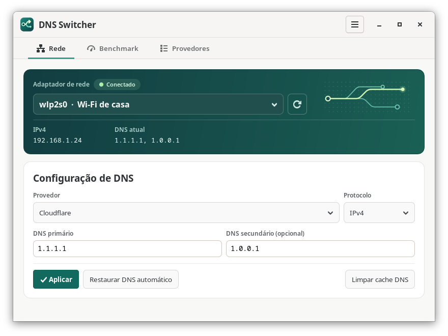

# DNS Switcher for Fedora

A portable desktop app for changing and benchmarking DNS servers on Fedora Linux. Built with C#/.NET 8, GTK 3 and NetworkManager.

[Português (Brasil)](README.pt-BR.md)



## Features

- Select an active network interface and inspect its connection profile, IPv4 address and DNS servers.
- Apply Google, Cloudflare, Quad9, OpenDNS, AdGuard or CleanBrowsing Family DNS, or enter custom IPv4/IPv6 servers.
- Restore automatic DNS for both IP families and flush the systemd-resolved cache.
- Benchmark primary and secondary servers with configurable domains and rounds, cancellation, latency statistics and failure rates.
- Apply the fastest server and manage providers through JSON import/export.
- Portuguese and English interfaces, light/dark appearance, a custom icon and optional tray menu.
- Command-line support and a launcher for the Fedora application menu.

## Run

Extract the portable Linux x86_64 package into a writable folder and run:

```bash
./dnsswitcher
```

The executable includes .NET 8. The system must provide GTK 3, NetworkManager with `nmcli`, and systemd-resolved with `resolvectl` for cache flushing. Tray integration additionally uses `libappindicator-gtk3` and a compatible panel.

Open the app in your normal desktop session. NetworkManager checks permissions through PolicyKit. Preferences are stored in `dnsswitcher.json` beside the executable. DNS changes persist in the selected NetworkManager connection profile.

Choose **Add to application menu** in the window menu, or run:

```bash
./dnsswitcher --install-launcher
```

Repeat this after moving the application. The launcher and icon are registered for your user.

## Command line

Use the interface name returned by `--list`, or its connection profile UUID.

```bash
./dnsswitcher --list
./dnsswitcher --apply cloudflare --adapter wlp1s0
./dnsswitcher --apply quad9 --family 6 --adapter wlp1s0
./dnsswitcher --reset --adapter wlp1s0
./dnsswitcher --flush
```

The CLI defaults to IPv4. Without an adapter argument, it uses the remembered profile, or the only active profile on first use. Exit codes are 0 for success, 1 for an operational error and 2 for invalid arguments.

## Build and test

Install the .NET 8 SDK, then run from the repository root:

```bash
dotnet build -c Release
dotnet test -c Release --no-build
dotnet publish src/DnsSwitcher.Fedora/DnsSwitcher.Fedora.csproj -c Release -r linux-x64 --self-contained true -p:PublishSingleFile=true -p:EnableCompressionInSingleFile=true -p:DebugType=None -p:DebugSymbols=false -o dist
```

The portable executable is `dist/dnsswitcher`. GTK remains a system dependency.

## Project layout

```text
src/
  DnsSwitcher.Core/       Models, validation, configuration and UDP benchmark
  DnsSwitcher.Fedora/     GTK interface, CLI and NetworkManager services
tests/
  DnsSwitcher.Tests/      xUnit validation, JSON, DNS and NetworkManager tests
docs/
  screenshot.png         Interface preview using example connection data
```

The project includes 49 tests. Previous verification on Fedora covered GUI navigation and benchmark cancellation, and IPv4/IPv6 changes, automatic DNS restoration and cache flushing against isolated NetworkManager/systemd-resolved instances.

## Benchmark and limitations

The benchmark sends A queries over UDP port 53 through the selected interface, with a two-second timeout and up to eight servers in parallel. The default is three rounds per domain. Results sort by successful-response average and show failures separately. Negative, truncated, invalid and missing answers count as failures. Check failure rates when choosing a server.

The application manages active NetworkManager profiles. A profile shared by multiple active interfaces requires separate profiles for individual changes. VPNs, split DNS and network policy can affect effective resolution. Restoring automatic DNS clears manual servers and accepts network-provided servers for both families. A manually addressed connection may have none.

The JSON file supports up to 64 providers and must be writable. A lock file coordinates updates. Rename the configuration file while the application is closed to recreate defaults.

## Dependencies

[GtkSharp](https://github.com/GtkSharp/GtkSharp) supplies GTK bindings. Network configuration uses [NetworkManager](https://networkmanager.dev/docs/api/latest/nmcli.html), and cache flushing uses [resolvectl](https://www.freedesktop.org/software/systemd/man/latest/resolvectl.html).
